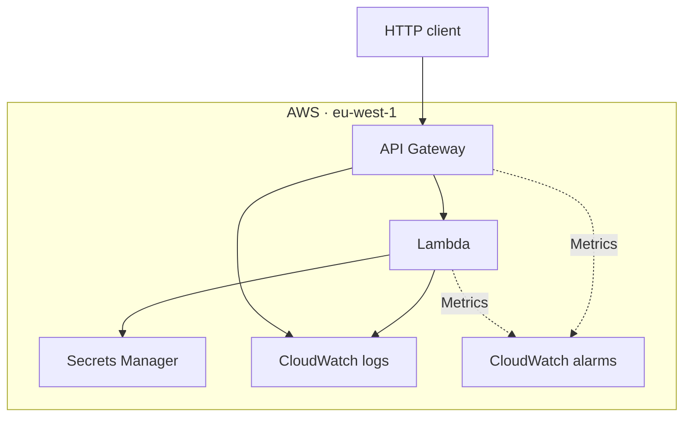
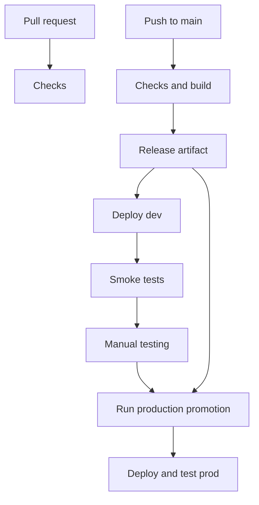

# AWS HTTP API

A small Node.js and TypeScript API deployed to AWS using Terraform and GitHub Actions. The focus is repeatable deployments, separate environments and practical operational controls. The terraform state is backed up and stored with an S3 bucket in AWS. This allows a team to use terraform and share the infrastructure state, instead of handling it locally and running into constant infrastructure locks.

## Architecture

API Gateway receives HTTPS requests and invokes Lambda. The function reads a demonstration secret from Secrets Manager using its runtime IAM role. Application logs, API access logs and alarms are held in CloudWatch.



The API is public and has no application authentication. There is no VPC or private network: Lambda uses AWS-managed networking and calls Secrets Manager through its regional endpoint. IAM controls access to AWS resources.

Lambda and API Gateway suit this small, intermittent workload: there are no servers to maintain or idle containers to run. The tradeoffs include cold starts, execution limits and less control over the runtime than a container service.

## Endpoints

| Endpoint | Purpose |
| --- | --- |
| `GET /health` | Basic service health |
| `GET /mockData` | Returns mock data |
| `GET /dependency-check` | Checks that the demonstration secret can be read and validated; does not return its value |

## Environments

Dev and prod use the same Terraform module, with separate resources, deployment roles and state files in one AWS account and region.

| Setting | Dev | Prod |
| --- | --- | --- |
| Lambda memory | 128 MB | 256 MB |
| Log retention | 7 days | 30 days |
| State key | `dev/terraform.tfstate` | `prod/terraform.tfstate` |
| Deployment | Automatic from main | Manual promotion |

State is stored in a private, encrypted, versioned S3 bucket. Native S3 state locking prevents concurrent Terraform writes to the same state. Separate AWS accounts would provide stronger environment isolation.

## Deployment

Pull requests run typechecking, tests, a build, Terraform formatting and validation for both environments. They do not deploy or authenticate to AWS.

A push to main runs the checks, saves the application build and checksum, deploys dev, then smoke-tests the endpoints. Production is promoted manually using the successful dev workflow run ID. It uses the same application artifact and Terraform configuration from that commit.



To promote, open **Actions → the production promotion workflow → Run workflow** and enter the successful dev run ID. Promotion checks the source workflow, result and commit, and requires the commit to match the current main branch. Artifacts are retained for 14 days.

The manual workflow is a deliberate promotion step, not an independent reviewer approval gate. Required environment reviewers are unavailable on the current repository plan. Deployment jobs use per-environment concurrency controls, and Terraform applies the saved plan.

## Run the checks locally

Requires Node.js 22, Terraform 1.16.5 and AWS CLI for deployments.

```bash
npm --prefix api ci
npm --prefix api run typecheck
npm --prefix api test
npm --prefix api run build
terraform fmt -check -recursive infra

terraform -chdir=infra/environments/dev init -backend=false -lockfile=readonly
terraform -chdir=infra/environments/dev validate
terraform -chdir=infra/environments/prod init -backend=false -lockfile=readonly
terraform -chdir=infra/environments/prod validate
```

Use GitHub Actions for normal deployments. For a local deployment, authenticate with an authorised AWS profile, build the API, then run `init`, `plan` and `apply` from the relevant environment directory. Initialise with the real backend before planning; if previously initialised without it, use `init -reconfigure`. Review the plan before applying.

## Access and secrets

- GitHub Actions authenticates through OIDC using temporary credentials. Each environment has its own AWS role and environment-specific trust policy.
- The Lambda runtime role is separate from deployment roles and can read only its configured secret and write application logs.
- Terraform creates secret metadata and access permissions. Secret values are entered separately in Secrets Manager, keeping them out of Terraform configuration and state.
- The function caches the secret for 60 seconds per execution environment. A missing or invalid secret causes the dependency check to fail.

The IAM roles, deployment policies, OIDC provider and state bucket were initially configured manually. `infra/bootstrap/` contains a proposed Terraform migration for the IAM/OIDC resources, based on an export of the existing setup. **It has not been imported or validated through a live AWS Terraform plan.** See its README for scope and next steps.

## Operations and tradeoffs

CloudWatch holds Lambda logs and structured API access logs. Alarms cover Lambda errors, throttles and API Gateway 5xx responses; notification delivery is not configured. API throttling is configured, but it is not a hard spending limit.

The API Gateway stage uses a provider alias without default tags following a tagging permission failure during deployment. This workaround is isolated to the stage; resolving the underlying permission issue remains follow-up work.

The service has been deployed to dev and prod and smoke-tested. The demonstration secret must be populated separately in each environment for `/dependency-check` to succeed.

## With more time

- Complete and review the IAM bootstrap import, tighten deployment permissions and bring the state bucket configuration into Terraform.
- Add protected branches, independent production approval and action references pinned to commit SHAs.
- Add alarm notifications, dashboards, secret-cache tests and stronger smoke-test assertions.
- Load-test concurrency and throttling, add authentication where required, and introduce a rollback strategy using Lambda versions and aliases.

This is a single-region demonstration. No multi-region failover is implemented.

## Cleanup

Review and run `terraform destroy` separately for dev and prod using authorised credentials. Secrets use a recovery window, so their names cannot immediately be reused after deletion. The state bucket and manually configured IAM/OIDC resources remain. Do not destroy the bootstrap root as part of application cleanup.

## Assumptions and future considerations

### Intended use and security

This example assumes a public API serving non-sensitive mock data, so caller authentication is not implemented. The dependency-check endpoint demonstrates secret access; in a real service, I would protect it or keep it internal.

For customer-facing use, I would add JWT authentication and authorisation checks for the requested resources. For calls between AWS services, IAM authentication may be more appropriate.

If access had to stay within a company network, I would consider a private API Gateway REST API, an interface VPC endpoint and connectivity from the company network. Putting Lambda in a VPC alone would not make the current API endpoint private.

### Scaling

Lambda provides automatic scaling within AWS quotas, but downstream services may have lower capacity. Before increasing traffic limits, I would load-test the service and measure latency, errors, throttling and cost.

I would tune API throttling and consider Lambda reserved concurrency to protect dependencies. Longer-running processing could move to a queue and worker, keeping HTTP requests short. Caching or provisioned concurrency would depend on measured requirements.

### Working as a team

The setup provides shared state with locking, separate environment roles, automated checks and promotion of the same application artifact.

For a larger team, I would add protected branches, independent production approval and read-only Terraform plans for trusted pull requests. Engineers would use individual AWS identities, with administrative IAM changes managed separately from application deployments.

Operational ownership would also need to be agreed: who receives alerts, investigates failures, rotates secrets and approves releases. A short runbook would cover rollback and recovery if the deployment pipeline were unavailable.